# LoanSight AI — 프로젝트 문서

**기업 여신심사를 위한 핵심 재무정보 시각화·실적 변동·재무와 주석 결합 상환·연체 위험 분석 웹 서비스**

## 기준 문서와 개정 이력

README 갱신일: **2026-10-24** · 팀: **KB Bridge 4조참치** · 검토 전 계획과 실제 구현·검증 결과를 구분합니다.

| 구분 | 최신 버전 · 개정일 | 원문·상세 |
| --- | --- | --- |
| 기획안 | v2.0 | LoanSight_AI_기획안_v2.0.docx |
| PRD | [prd.md](01-planning/prd.md) |
| WBS | [wbs.md](01-planning/wbs.md) |
| 요구사항 정의서 | v0.0.4 · 2026.10.23 | [요구사항 상세·원문](https://app.notion.com/p/3f980be201ba80b68d44c5574e88c531) |
| PRD | v0.0.4 · 2026.10.24 | [PRD 상세·원문](https://app.notion.com/p/3fe80be201ba805f92d3ee2ae51ee823) |
| 기능명세서 | v0.0.4 · 2026.10.24 | [기능 상세·원문](https://app.notion.com/p/3f980be201ba80f793a9f39755ab785a) |
| WBS | v1.1 · 2026.10.24 | [WBS 상세·원문](https://app.notion.com/p/3ff80be201ba80618c52cb61cc4a6153) · [69개 작업표](https://app.notion.com/p/d91257f6902d44e3a092085fac13da35) |

요구사항 43개(N-R01~43), 기능 41개(N-F01~41), 화면 8개(N-S01~08), 미정 질문 20개(N-U01~20)를 관리합니다. WBS는 기존 56개 ID를 유지하고 13개를 추가한 69개 작업입니다. WBS의 독립 버전 v1.0→v1.1과 요구사항·PRD·기능명세서의 v0.0.4를 구분합니다. ID 연결과 문서 개정은 구현·테스트 통과를 뜻하지 않습니다.

| README 개정일 | 변경 내용 |
| --- | --- |
| 2026.10.22 | LoanSight AI 명칭과 기획안 v1.0 기준 소개 |
| 2026.10.24 | 기획안 v2.0·요구사항 v0.0.4·WBS v1.1 반영. 4개 업종/렌탈 제외, 상환·연체 위험 사건 목표, 지표·단계·패널·주석 추출/검출 상태, 미정 표본과 최신 문서 연결 갱신 |

기획안과 요구사항이 충돌하는 부분에는 요구사항의 명시적 10/23 팀 결정(4개 업종 확정·장비/물품 렌탈 제외·기능 검증 15곳/정답지 5곳 논의 필요)을 적용합니다.

## 프로젝트 개요

은행의 기업금융·여신심사 담당자가 영업이익·현금흐름 변화와 공시 주석의 위험 근거를 함께 검토하도록 돕는 웹 서비스입니다. 재무지표와 구조화한 주석을 결합해 향후 **12개월 상환·연체 위험 사건 발생 확률**을 추정하는 모델을 개발 범위에 포함합니다. 업종별 지표·규칙 기반 징후 단계·원문 근거를 확인하고 담당자가 체크·수정할 수 있는 검토 기록 초안으로 연결합니다. 최종 여신 판단은 담당자가 수행합니다.

현직자 인터뷰에서 확인한 문제는 재무제표 탐색과 심사 항목 작성의 불편, 시각화 부족, 뉴스 확인에 쓸 시간 부족입니다. 감가상각은 업종·자산 구성에 맞게 강조하며 모든 업종에 같은 중요도를 적용하지 않습니다.

## 서비스 흐름

**기업 검색·업종 선택 → 자료 수집·기준 통일 → 재무·주석 분석 → 규칙 위험 패널·12개월 위험 사건 확률 확인 → 담당자 체크·검토 기록 → 최종 판단**

[피그마에서 서비스 흐름도 열기·편집](https://www.figma.com/board/z820q0Vi1K3WhdGZEBTZFY)

아래 흐름도는 기획한 서비스 구조입니다. 개별 기능의 구현·학습·검증 완료를 뜻하지 않습니다. 뉴스는 사업상 원인 검토의 보완 기능이며 초기 위험 사건 예측 모델 입력에서 제외합니다.

```mermaid
flowchart LR
  subgraph preparation ["1. 기업 선택·자료 준비"]
    company(["기업 검색·업종 선택"])
    disclosure["공시·재무제표·주석 수집"]
    normalize["기간·단위·회계 기준 통일"]
    company --> disclosure --> normalize
  end
  subgraph analysis ["2. 재무·주석 결합 분석"]
    financial["영업이익·현금흐름·변동 분석"]
    notes["공통·업종 주석 추출·근거 요약"]
    panel["업종 지표·규칙 징후 패널"]
    prediction["재무·주석 결합 위험 사건 예측"]
    financial -->|"재무지표"| prediction
    notes -->|"소송·보증·담보 정보"| prediction
  end
  subgraph review ["3. 근거 확인·심사 업무 지원"]
    dashboard["핵심 재무·위험 근거 대시보드"]
    check{"추가 확인이 필요한가?"}
    internal["담당자 원문·내부 자료 확인"]
    checklist["담당자 확인 체크·누락 점검"]
    memo["검토 기록 초안·담당자 수정"]
    judgment(["담당자 최종 여신 판단"])
    dashboard --> check
    check -->|"필요"| internal
    internal --> checklist
    check -->|"확인 완료"| checklist
    checklist --> memo --> judgment
  end
  subgraph supplementary ["보완 기능 · 초기 예측 모델 입력에서 제외"]
    newsSearch["기업·기간별 뉴스 검색"]
    newsFilter["기업·실적 관련성 재검증"]
    newsSummary["관련 뉴스 요약·원문 링크"]
    newsSearch --> newsFilter --> newsSummary
  end
  normalize --> financial
  normalize --> notes
  financial -->|"수치·변동 내역"| dashboard
  notes -->|"확인 사실·원문 근거"| dashboard
  financial -->|"업종별 지표"| panel
  notes -->|"원문·검출 상태"| panel
  panel -->|"경고·주의·관찰 · 현재 규칙"| dashboard
  prediction -->|"검증 후 향후 12개월 위험 사건 확률"| dashboard
  company -.-> newsSearch
  newsSummary -.->|"사업상 원인 검토 보완"| dashboard
  style preparation fill:#F5F5F5,stroke:#B3B3B3
  style analysis fill:#EEF6FF,stroke:#3DADFF
  style review fill:#F0FAF2,stroke:#66D575
  style supplementary fill:#FFFAEC,stroke:#FFC943
  style prediction fill:#DCCCFF,stroke:#874FFF
  style check fill:#FFECBD,stroke:#FFC943
  style judgment fill:#CDF4D3,stroke:#66D575
```

## 핵심 기능

| 기능 | 제공할 내용 |
| --- | --- |
| 기업 검색·업종 판정 | 기업·DART 업종코드·서비스 업종·세부분류·보고 기간·연결/별도 기준, 수동 업종 변경 사유·근거 기록 |
| 핵심 재무 대시보드 | 영업이익·현금흐름, 차입·상환능력·영업순환·운전자본과 업종별 중요 항목 |
| 실적 변동·현금흐름 분석 | 매출·원가·판관비 변동 기여도, 이익·현금흐름 차이, 기존 3개년 추세와 비교 가능한 업종 분포 |
| 공통·업종별 주석 추출·요약 | 원문 구간·교차참조·금액/방향/시점·만기·검수 상태와 근거 있는 요약 |
| 업종별 위험징후 패널 | 기존 주석 화면 N-S04에 6개 판단 축·업종 지표, 경고/주의/관찰, 5개년 추세·업종 맞춤 차트·원문 근거 |
| 재무·주석 결합 위험 사건 예측 | 향후 12개월 상환·연체 위험 사건 확률 추정, 재무 단독 기준 모델과 비교·확률 보정 검증 |
| 심사 확인 체크 | 규칙 징후 단계·모델 확률·담당자 확인 상태를 분리하고 미확인 항목 관리 |
| 검토 기록 초안 | 핵심 수치·변동·주석·징후/예측 근거·추가 확인 사항을 복사·수정 |
| 관련 뉴스 (보완) | 기업·실적 관련성을 검수한 기사 요약·날짜·출처·원문 링크. 초기 모델 입력에서 제외 |

규칙 단계는 담당자의 확인 순서를 돕기 위한 것이며 은행 건전성 분류·내부 등급·자동 승인/거절을 대신하지 않습니다. 1배·3년 등의 단계 수치는 팀 가설로 표시하며 현직자 확인 전 확정 기준으로 사용하지 않습니다. 경고는 상단 고정·원문 확인 필수, 주의는 확인 항목에 추가합니다.

회계상 변동 분해와 사업상 인과 설명을 구분합니다. 검출 상태는 **검출·공시상 없음·미검출·추출 실패**로 나눕니다. 미검출·금액 미기재·추출 실패를 0이나 해당 사항 없음으로 바꾸지 않고 일반 담보·차입약정을 자동으로 우발부채로 판단하지 않습니다. 외부 공시로 확인할 수 없는 내용은 담당자의 내부 자료 확인으로 연결합니다.

## 데이터와 분석 계획

- **초기 대상:** 공시·재무 확보가 가능한 상장사를 우선하며 **제조·건설·도소매·부동산 임대 4개 업종**을 적용합니다. 부동산 임대에 장비/물품 렌탈을 포함하지 않습니다. 금융·보험, 지주회사, 스팩, 운수·창고, 부동산 관리·중개도 제외합니다. 세부분류·겸업 판정·기업·기간은 미정 질문에서 관리합니다.
- **수집원:** OpenDART 기업개황·공시검색·전체 재무제표·공시서류 원본, 주요사항보고서·감사보고서·기한이익상실 공시를 활용할 계획입니다. 회사·접수번호·공개일·수집일·보고서 버전·정정 관계와 원문 위치를 기록합니다.
- **전처리:** 연결/별도, 기간, 누적/당분기, 통화·단위·정정 자료를 구분하고 계정 매핑·합계·부호·결측/0을 점검합니다. 평균/기말 잔액, 이자비용 근사, 임대보증금 포함 여부는 미정 상태를 유지합니다.
- **공통 추출 6항목:** 감사의견/계속기업, 차입 만기/재무약정, 신용등급, 담보 제공, 소송/제재, 부외거래/후속사건을 원문 구간 단위로 추출하고 교차참조를 따라갑니다.
- **업종 추가 추출:** 제조 재고평가/손상/설비투자, 도소매 리스/공급자금융/점포, 건설 PF/계약자산/공사원가/분양, 부동산 임대 차입/투자부동산/임대율/보증금 등의 사전을 둡니다. PF 한도·보증금액·실행잔액과 총괄/하위 표 중복을 구분합니다.
- **지표·판단 축:** 상환재원, 유동성·만기, 재무구조, 우발·부외 부담, 외부 평가, 담보·회수 여력의 6축에 공시 지표·주석을 연결합니다. 위험 패널의 5개년 추세와 기존 3개년 비교를 구분하고, 업종 표본 부족은 비교 보류로 표시합니다.
- **AI 역할:** 주석 구조화·근거 요약에 활용합니다. 수치·비율 계산과 확률 산출은 분석 코드·모델이 수행합니다. 검증된 주석 특징만 모델 입력 후보로 사용하고 뉴스·LLM 임의 확률은 초기 모델 입력에서 제외합니다.

### 상환·연체 위험 사건 예측과 검증

실제 원리금 연체·기한이익상실, 어음·수표 지급거절, 회생/채권은행 관리절차 신청, 감사의견 변형·계속기업 불확실성 등을 원문 근거·공개시점과 함께 유형별로 정의합니다. 유형별 심각도·세부 판정은 미정입니다. 상환과 무관한 관리종목 지정·상장폐지는 제외하고, API 미조회만으로 비발생 라벨을 부여하지 않습니다.

공시 당시 알 수 있는 정보만 입력하고 향후 12개월 사건과 비발생·추적 미완료를 구분합니다. 학습 결과가 검증 시작 전에 확정되도록 시점을 나누며 기업 반복 관측·정정 공시의 누출을 점검합니다. 감사의견을 특징과 사건에 사용하는 시점도 구분합니다.

같은 기업·기간·평가 표본에서 재무 로지스틱 회귀 기준 모델과 재무·주석 결합 모델을 비교합니다. PR-AUC, 정밀도·재현율, Brier 점수·확률 보정과 업종별 표본 한계를 기록합니다. 결합 모델·수용/표시/보류 기준과 실제 성능은 확정하지 않았습니다.

**기능 검증 15곳·정답지 5곳은 논의 필요**이며 모델 학습/평가 표본과 구분합니다. 기획안이 인용한 추출 40개사, 계정 점검 업종별 5개 이상 계획도 서로 다른 표본입니다. 확보율 70%는 예시로, 확정 합격 기준이 아닙니다.

예측 결과에는 기간·기준일·모델 버전·관련 지표·주석 원문·검증/보류 상태를 표시합니다. 학습·검증 전 임의 확률을 실제 결과로 표시하지 않으며 변수 영향은 인과관계로 해석하지 않습니다.

## 개발·검증 범위

기획안 v2.0은 기존 로컬 시연 기반에 업종 지표·위험 패널, 주석 추출/요약·검출 상태, 재무·주석 결합 위험 사건 모델, 체크/메모와 근거 화면을 확장할 계획입니다. 문서 작성·파일 존재와 구현·실행·실데이터 검증 완료를 구분합니다.

계획 기간은 2026.10.21~11.05이며 기획안의 11/05 09:00 제출과 실제 교육 마감의 일치는 N-U09에서 확인합니다. 담당·세부 날짜·선행관계는 WBS 실행 초안입니다. 날짜가 지나도 실제 진척을 확인하지 않고 완료 처리하지 않습니다.

WBS는 필수 59개·뉴스 보완 3개·마일스톤 7개이며 기존 완료 2개는 과거 기획안/발표 초안 기록입니다. 모델 성능·업무 시간 절감·누락 감소는 측정 후 기록합니다. 기능/정답지·추출·계정 확보·모델 평가·사용자 실험의 표본을 구분합니다.

업종 확대·비상장/스타트업·외부 업종 통계·PDF·지점별 운영은 핵심 검증 후의 확장입니다. 미정 질문 20개와 가설 임계값·추출 합격 기준·최소 비교 표본·차트 우선순위를 임의로 확정하지 않습니다.

## 팀 문서

- [Notion 프로젝트 README](https://app.notion.com/p/3fb80be201ba80ec8928d9c01e41e517)
- [실행 코드 저장소](https://github.com/loansight-ai/code)
- [기획 산출물 · PRD·요구사항·기능 명세](https://app.notion.com/p/40080be201ba8159ae7fcd1aebce0000)
- [WBS](https://app.notion.com/p/3ff80be201ba80618c52cb61cc4a6153)
- [팀 홈](https://app.notion.com/p/3f980be201ba80e38725cb2321445e44)
- [서비스 흐름도 · FigJam](https://www.figma.com/board/z820q0Vi1K3WhdGZEBTZFY)

팀원: 김동혁(팀장·데이터), 최수인(부팀장·기획), 김동민(데이터), 서종원(개발), 오준탁(기획). 세부 작업 분담은 WBS와 팀 합의 내용을 기준으로 확인합니다.

## GitHub 문서 목차

기획안 v2.0·요구사항/PRD/기능명세서 v0.0.4·WBS v1.1의 전체 상세와 편집 원문을 [기획 문서 목록](01-planning/README.md)에 게시했습니다. [정합성 점검 결과](01-planning/alignment-check.md)에서 노션·원문·GitHub 전수 비교 범위와 미정 사항을 확인합니다.

| 문서 | 위치 |
| --- | --- |
| 기획안 | [proposal.md](01-planning/proposal.md) |
| 요구사항 정의서 | [requirements.md](01-planning/requirements.md) |
| 기능 정의서 | [functions.md](01-planning/functions.md) |
| 설계 산출물 | [02-design](02-design/README.md) |
| 수행일지 | [03-daily-logs](03-daily-logs/README.md) |
| 이슈·오류 기록 | [04-issue-logs](04-issue-logs/README.md) |
| 테스트 케이스 | [test-cases.md](05-testing/test-cases.md) |
| 발표 자료 | [06-presentation](06-presentation/README.md) |
| 최종 제출 체크리스트 | [checklist.md](07-submission/checklist.md) |
| 회의록 | [meetings](meetings/README.md) |
| 공통 양식 | [templates](templates/README.md) |

## 문서 관리 규칙

- [GitHub 협업 규칙](CONTRIBUTING.md)에 따라 Issue → 브랜치 → PR → 검증·병합 순서로 변경합니다.
- 문서마다 담당자·검토자·상태·수정일을 기록하고 미확인 사항을 구분합니다.
- 요구사항·기능·테스트 ID를 연결합니다. 예: `N-R01 → N-F01 → code PR → N-T01`.
- 개발·데이터 처리·오류는 [code Issues](https://github.com/loansight-ai/code/issues), 문서·제출 준비는 이 저장소에서 관리합니다.
- 지정 제출 양식의 편집 원본과 제출본을 함께 보관하며, 실제 파일과 검증 근거를 연결합니다.
- 제출 시 문서·코드의 커밋 SHA 또는 태그와 제출 파일 목록을 기록하고 이후 변경과 구분합니다.
- API 키·토큰·비밀번호·민감한 개인정보는 저장하지 않습니다.
