# 재무나침반 (가제) — 프로젝트 문서

**기업 여신심사를 위한 핵심 재무정보 시각화·실적 변동·재무와 주석 결합 부도위험 분석 웹 서비스**

기획 기준: 재무나침반 기획안 v1.0 · README 갱신: 2026-10-22 · 팀: KB Bridge 4조참치

## 프로젝트 개요

은행의 기업금융·여신심사 담당자가 영업이익과 현금흐름 변화를 빠르게 파악하고, 공시 주석의 소송·보증·담보 정보를 함께 검토하도록 돕습니다. 재무지표와 구조화한 주석 정보를 결합한 향후 12개월 부도 확률 예측을 개발 범위에 포함합니다. 확인된 수치·원문 근거·미확인 사항을 검토 기록 초안으로 연결하고, 최종 여신 판단은 담당자가 수행합니다.

현직자 인터뷰에서 확인한 문제는 재무제표 탐색과 심사 항목 작성의 불편, 시각화 부족, 뉴스 확인에 쓸 시간 부족입니다. 감가상각은 임대업 사례에서 중요성이 제기된 항목으로, 모든 업종에 동일한 우선순위를 적용하지 않습니다.

## 서비스 흐름

**기업 검색·업종 선택 → 자료 수집·기준 통일 → 재무·주석 분석 → 부도 확률·관련 근거 확인 → 담당자 체크·검토 기록 → 최종 판단**

[피그마에서 서비스 흐름도 열기·편집](https://www.figma.com/board/z820q0Vi1K3WhdGZEBTZFY)

아래 흐름도는 기획한 서비스 구조입니다. 개별 기능의 구현·학습·검증 완료를 뜻하지 않습니다. 뉴스는 사업상 원인 검토의 보완 기능이며 초기 부도 예측 모델 입력에서 제외합니다.

```mermaid
flowchart LR
  subgraph preparation ["1. 기업 선택·자료 준비"]
    company(["기업 검색·업종 선택"])
    disclosure["공시·재무제표·주석 수집"]
    normalize["기간·단위·회계 기준 통일"]
    company --> disclosure --> normalize
  end
  subgraph analysis ["2. 재무·주석 결합 분석"]
    financial["영업이익·현금흐름·변동 분석"]
    notes["AI 주석 추출·요약"]
    prediction["재무·주석 결합 부도 예측"]
    financial -->|"재무지표"| prediction
    notes -->|"소송·보증·담보 정보"| prediction
  end
  subgraph review ["3. 근거 확인·심사 업무 지원"]
    dashboard["핵심 재무·위험 근거 대시보드"]
    check{"추가 확인이 필요한가?"}
    internal["담당자 원문·내부 자료 확인"]
    checklist["담당자 확인 체크·누락 점검"]
    memo["검토 기록 초안·담당자 수정"]
    judgment(["담당자 최종 여신 판단"])
    dashboard --> check
    check -->|"필요"| internal
    internal --> checklist
    check -->|"확인 완료"| checklist
    checklist --> memo --> judgment
  end
  subgraph supplementary ["보완 기능 · 초기 예측 모델 입력에서 제외"]
    newsSearch["기업·기간별 뉴스 검색"]
    newsFilter["기업·실적 관련성 재검증"]
    newsSummary["관련 뉴스 요약·원문 링크"]
    newsSearch --> newsFilter --> newsSummary
  end
  normalize --> financial
  normalize --> notes
  financial -->|"수치·변동 내역"| dashboard
  notes -->|"확인 사실·원문 근거"| dashboard
  prediction -->|"검증 후 12개월 추정 확률"| dashboard
  company -.-> newsSearch
  newsSummary -.->|"사업상 원인 검토 보완"| dashboard
  style preparation fill:#F5F5F5,stroke:#B3B3B3
  style analysis fill:#EEF6FF,stroke:#3DADFF
  style review fill:#F0FAF2,stroke:#66D575
  style supplementary fill:#FFFAEC,stroke:#FFC943
  style prediction fill:#DCCCFF,stroke:#874FFF
  style check fill:#FFECBD,stroke:#FFC943
  style judgment fill:#CDF4D3,stroke:#66D575
```

## 핵심 기능

| 기능 | 제공할 내용 |
| --- | --- |
| 기업 검색·업종 필터 | 기업 식별, 업종·보고 기간·연결 또는 별도 기준 확인 |
| 핵심 재무 대시보드 | 영업이익 우선 표시, 업종별 중요 항목 강조 |
| 실적 변동·현금흐름 분석 | 매출·원가·판관비 변동 기여도, 영업이익과 영업현금흐름 차이, 비교 가능한 업종 분포 |
| AI 주석 추출·요약 | 소송·보증·담보의 금액·상태·기준일·원문 위치와 추가 확인 사항 |
| 재무·주석 결합 부도 예측 | 기준 공시일 이후 12개월 부도 확률 추정, 재무 단독 모델과 비교 검증 |
| 심사 확인 체크 | 시스템의 확인 필요 표시와 담당자의 확인 완료 상태 구분 |
| 검토 기록 초안 | 핵심 수치·변동·주석 근거·예측 결과·미확인 사항 정리 및 담당자 수정 |
| 관련 뉴스 (보완) | 기업·실적 관련성 재검증, 요약·기사 날짜·출처·원문 링크 |

회계상 변동 분해와 실제 사업상 원인 설명을 구분합니다. 자료 미확보·추출 실패·금액 미기재를 0이나 해당 사항 없음으로 처리하지 않으며, 외부 공시로 확인할 수 없는 내용은 담당자에게 내부 자료 확인을 안내합니다.

## 데이터와 분석 계획

- **초기 대상:** 공시와 재무정보를 확보할 수 있는 상장사를 우선 검증합니다. 업종 약 5개를 조사하고 자료 확보·비교 가능성을 확인해 확정합니다. 코넥스는 상장시장으로 구분하며 비상장·스타트업은 자료 확보 가능성 확인 후 확대합니다.
- **수집원:** OpenDART 기업개황·공시검색·전체 재무제표·공시서류 원본 및 부도발생 공시를 활용합니다. 기업·보고서·접수번호·공시일·수집일을 관리합니다.
- **전처리:** 연결·별도, 보고 기간, 누적·당분기, 통화·단위, 정정공시를 구분합니다. 표준계정 매핑과 합계·부호·누락 검사를 수행합니다.
- **AI 역할:** 주석을 구조화하고 근거 있는 요약을 만듭니다. 수치·비율 계산과 부도 확률 산출은 분석 코드와 예측 모델이 수행합니다.
- **주석 변수:** 소송 청구금액·진행 상태, 회사가 제공한 보증·담보의 금액·대상·한도·잔액을 후보로 구성합니다. 제공과 수취, 진행 중과 종결, 미기재와 추출 실패를 구분합니다.

### 부도 확률 예측과 검증

동일 기업·기간·평가 표본에서 재무지표만 사용하는 로지스틱 회귀 기준 모델과 재무·주석 결합 모델을 비교합니다. 실제 부도 사건일을 원문과 대조하고 공시 당시 알 수 있던 자료만 입력합니다. 조회 결과가 없거나 회생신청·상장폐지가 있다는 이유만으로 정상·부도 라벨을 임의 부여하지 않습니다.

학습·검증·평가 시점을 분리하고 12개월 관측 기간과 정보 누출을 점검합니다. PR-AUC, 정밀도·재현율, Brier 점수·확률 보정으로 주석의 추가 예측 가치를 확인합니다. 기능 검증용 기업 15곳과 상세 정답지 5곳은 학습 표본과 구분합니다. 학습·검증 전의 임의 확률을 실제 결과로 표시하지 않습니다.

예측 결과에는 기준일·예측 기간·모델 버전·관련 재무지표·주석 원문·추가 확인 사항을 함께 제시합니다. 부도 확률은 검토 보조 정보이며 대출 승인·거절이나 내부 등급을 자동 결정하지 않습니다.

## 개발·검증 범위

기획안 v1.0은 기존 웹 시연 코드를 출발점으로 업종별 분석, AI 주석 추출·요약, 재무·주석 결합 부도 예측, 확인 체크와 결과 화면의 확장을 계획합니다. 모델 학습·성능, 업무 시간 절감과 누락 감소는 별도의 실데이터 검증·비교 실험으로 확인할 항목입니다.

약 2주간 핵심 기능 구현 후 검증·발표 준비를 진행합니다. 실제 일정·담당·완료 상태는 WBS에서 관리합니다. 업종 확대, 비상장 지원, 외부 업종 통계, PDF 출력 등은 후속 확장 항목입니다.

## 팀 문서

- [Notion 프로젝트 README](https://app.notion.com/p/3fb80be201ba80ec8928d9c01e41e517)
- [실행 코드 저장소](https://github.com/fin-ai-lab-2026/code)
- [기획 산출물 · PRD·요구사항·기능 명세](https://app.notion.com/p/40080be201ba8159ae7fcd1aebce0000)
- [WBS](https://app.notion.com/p/3ff80be201ba80618c52cb61cc4a6153)
- [팀 홈](https://app.notion.com/p/3f980be201ba80e38725cb2321445e44)
- [서비스 흐름도 · FigJam](https://www.figma.com/board/z820q0Vi1K3WhdGZEBTZFY)

팀원: 김동혁(팀장·데이터), 최수인(부팀장·기획), 김동민(데이터), 서종원(개발), 오준탁(기획). 세부 작업 분담은 WBS와 팀 합의 내용을 기준으로 확인합니다.

## GitHub 문서 목차

이 README는 기획안 v1.0과 위 Notion 산출물을 요약합니다. 아래 기존 상세 문서의 내용·검토 상태는 각 파일에서 별도로 확인합니다.

| 문서 | 위치 |
| --- | --- |
| 기획안 | [proposal.md](01-planning/proposal.md) |
| 요구사항 정의서 | [requirements.md](01-planning/requirements.md) |
| 기능 정의서 | [functions.md](01-planning/functions.md) |
| 설계 산출물 | [02-design](02-design/README.md) |
| 수행일지 | [03-daily-logs](03-daily-logs/README.md) |
| 이슈·오류 기록 | [04-issue-logs](04-issue-logs/README.md) |
| 테스트 케이스 | [test-cases.md](05-testing/test-cases.md) |
| 발표 자료 | [06-presentation](06-presentation/README.md) |
| 최종 제출 체크리스트 | [checklist.md](07-submission/checklist.md) |
| 회의록 | [meetings](meetings/README.md) |
| 공통 양식 | [templates](templates/README.md) |

## 문서 관리 규칙

- [GitHub 협업 규칙](CONTRIBUTING.md)에 따라 Issue → 브랜치 → PR → 검증·병합 순서로 변경합니다.
- 문서마다 담당자·검토자·상태·수정일을 기록하고 미확인 사항을 구분합니다.
- 요구사항·기능·테스트 ID를 연결합니다. 예: `REQ-001 → FUN-001 → code PR → TC-001`.
- 개발·데이터 처리·오류는 [code Issues](https://github.com/fin-ai-lab-2026/code/issues), 문서·제출 준비는 이 저장소에서 관리합니다.
- 지정 제출 양식의 편집 원본과 제출본을 함께 보관하며, 실제 파일과 검증 근거를 연결합니다.
- 제출 시 문서·코드의 커밋 SHA 또는 태그와 제출 파일 목록을 기록하고 이후 변경과 구분합니다.
- API 키·토큰·비밀번호·민감한 개인정보는 저장하지 않습니다.
